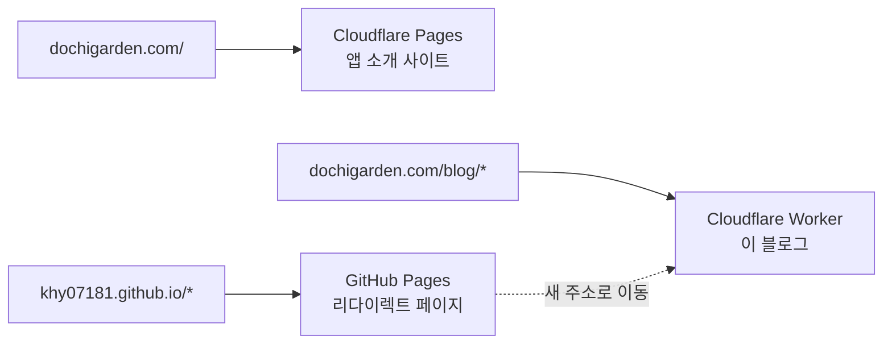

## 블로그 주소 변경하기

블로그의 주소를 `khy07181.github.io` 에서 `dochigarden.com/blog` 로 변경했다.

언젠가 나만의 도메인 주소를 가지고 싶기도 했고 [[Cloister — A quiet Cloisterfor focused work|Cloister]] 를 소개할 사이트가 필요해 `dochigarden.com` 이라는 도메인을 샀는데, 블로그도 그 아래로 옮겨오기로 했다.

그리고 도메인을 연결하고 싶었던 이유는 또 있었다.
블로그를 만든 뒤로 1년 넘게 Google Search Console 에서 sitemap 이 `가져올 수 없음` 상태였다.

![[gsc_sitemap_failed.webp]]

sitemap 파일도 정상이고, robots.txt 도 정상이고, 같은 sitemap 이 Bing 에서는 잘 수집되는데 구글에서만 안 됐다.
- 재제출, sitemap 위치 변경, 파일명 변경, 쿼리스트링 붙이기 등 할 수 있는 건 다 해봤다.

찾아보니 github.io 도메인에서 같은 증상을 겪는 사람이 꽤 많았고, 내가 시도해본 방법을 제외하고 확실하게 해결됐다는 사례는 **커스텀 도메인을 연결한 경우**뿐이었다.

이번 작업도 [[quartz-blog-version-up|지난 블로그 버전 업그레이드]] 때처럼 Claude의 도움을 받아 커스텀 도메인을 연결했다.

---

## sub domain vs sub directory

도메인 아래에 블로그를 두는 방법은 크게 두 가지다.

|         | sub domain : `blog.dochigarden.com` | sub directory : `dochigarden.com/blog` |
| ------- | ----------------------------------- | -------------------------------------- |
| 설정 난이도  | 쉬움 (GitHub Pages가 바로 지원, CNAME 하나)  | 경로를 나눠주는 리버스 프록시·엣지 라우팅이 필요            |
| 호스팅     | GitHub Pages 그대로                    | 보통 루트 사이트와 같은 플랫폼에서 처리                 |
| SEO     | 별개 사이트처럼 취급된다는 의견이 많음               | 루트 도메인과 평판을 공유                         |
| 주로 쓰는 곳 | 개인·기술 블로그                           | 회사·제품 사이트의 블로그                         |

잠시 고민하다가 [Sindre Sorhus](https://sindresorhus.com/) 의 사이트도 블로그를 `/blog` 아래에 두고 있는 걸 보고 나도 같은 방식으로 정했다.

---

## 호스팅 방식 정하기

GitHub Pages의 커스텀 도메인은 도메인 단위로만 연결된다. `dochigarden.com/blog` 처럼 경로 단위로는 연결할 수 없다.

그리고 `dochigarden.com` 루트는 이미 다른 저장소의 Cloudflare Pages가 서빙하고 있었다. 그래서 `/blog` 로 들어오는 요청만 블로그로 보내주는 장치가 Cloudflare 쪽에 필요했다.

선택지는 두 가지였다.

1. 블로그를 Cloudflare Worker로 이전
	- 빌드 결과를 Worker의 정적 에셋으로 올리고, `dochigarden.com/blog*` 경로에 라우트를 거는 방법
2. GitHub Pages 유지 + 프록시
	- 루트 사이트에 함수를 추가해서 `/blog/*` 요청을 `khy07181.github.io` 로 대신 받아오는 방법

2번은 블로그 배포 방식을 바꾸지 않아도 되지만, 요청이 한 번 더 거쳐 가고 두 저장소가 서로 엮인다. github.io 에 사본도 계속 살아 있게 된다.

이미 Cloudflare 를 쓰고 있었고, 경로 단위로 나누는 게 원래 Worker 라우트가 하는 일이라서 1번으로 정했다.

최종 구조는 이렇다.



- 같은 도메인이지만 경로에 따라 Cloudflare가 요청을 서로 다른 곳으로 보낸다
- 옛 주소로 들어온 요청은 GitHub Pages가 받아서 새 블로그 주소로 넘겨준다
	- 옛 주소는 일정 기간 유지 후 삭제

---

## 도메인 이전 과정

### 1. baseUrl 바꾸기

Quartz는 하위 경로 배포를 지원한다. `baseUrl` 에 경로까지 적어주면 된다.

```yaml
# quartz.config.yaml
configuration:
  baseUrl: dochigarden.com/blog
```

Quartz는 페이지 안의 링크를 전부 상대 경로(`./index.css`, `./2025/cap/`)로 만들어서, 하위 경로로 옮겨도 깨지는 게 없었다. `baseUrl` 은 sitemap, RSS, `og:url` 같은 절대 주소를 만들 때만 쓰인다.

로컬 미리보기도 실제와 같은 경로에서 열리도록 `--baseDir` 을 붙였다.

```shell
npx quartz build --serve --baseDir blog   # localhost:8080/blog
```

### 2. Cloudflare Worker 설정

Worker는 코드 없이 정적 파일만 서빙하는 assets-only로 만들었다.

```jsonc
// wrangler.jsonc
{
  "name": "dochigarden-blog",
  "compatibility_date": "2026-10-01",
  "routes": [
    { "pattern": "dochigarden.com/blog", "zone_name": "dochigarden.com" },
    { "pattern": "dochigarden.com/blog/*", "zone_name": "dochigarden.com" },
  ],
  "workers_dev": false,
  "preview_urls": false,
  "assets": {
    "directory": "./dist",
    "html_handling": "auto-trailing-slash",
    "not_found_handling": "404-page",
  },
}
```

### 3. CI에서 배포하기

블로그는 원래 GitHub Actions가 빌드해서 GitHub Pages로 올리고 있었다. 마지막 단계를 Cloudflare 배포로 바꿨다.

```yaml
      - name: Deploy blog to Cloudflare (dochigarden.com/blog)
        run: |
          rm -rf dist && mkdir dist && cp -R public dist/blog
          npx --yes wrangler@4 deploy
        env:
          CLOUDFLARE_API_TOKEN: ${{ secrets.CLOUDFLARE_API_TOKEN }}
          CLOUDFLARE_ACCOUNT_ID: ${{ secrets.CLOUDFLARE_ACCOUNT_ID }}
```

### 4. 기존 github.io 주소 처리하기

블로그를 옮겨도 구글에 색인된 주소, 여기저기 공유된 링크, RSS 구독은 전부 옛 주소(`khy07181.github.io`)를 바라보고 있다. 이걸 새 주소로 넘겨줘야 한다.

처음 떠오른 방법은 GitHub Pages 설정에 커스텀 도메인을 넣는 거였다. 그러면 GitHub이 옛 주소를 알아서 301 리다이렉트 해준다.

그런데 점검하다 보니, Cloister 앱의 업데이트 피드가 `khy07181.github.io/homebrew-cloister/appcast.xml` 에 있었다. 다른 저장소의 GitHub Pages다.

`khy07181.github.io` 같은 user site에 커스텀 도메인을 걸면, 그 아래 project site들까지 전부 그 도메인으로 넘어간다.

앱 업데이트 피드가 엉뚱한 곳으로 리다이렉트돼서 앱 업데이트가 깨질 뻔했다.
- ~~블로그 옮기다가 앱 업데이트를 망가뜨릴 했다.

대안: 페이지마다 리다이렉트 스텁 만들기

GitHub Pages는 서버 쪽 301을 할 수 없다. 그래서 빌드된 페이지마다 같은 경로에 HTML을 만들어 올렸다.

```html
<link rel="canonical" href="https://dochigarden.com/blog/2025/cap/">
<meta http-equiv="refresh" content="0; url=https://dochigarden.com/blog/2025/cap/">
<script>location.replace("https://dochigarden.com/blog/2025/cap/" + location.search + location.hash)</script>
```

### 5. giscus 댓글 이사시키기

[giscus](https://giscus.app/ko) 는 댓글을 GitHub Discussions에 저장하고, 페이지 URL을 기준으로 어떤 Discussion이 어떤 페이지 것인지 찾는다. URL이 바뀌면 기존 댓글이 안 보이게 된다.

Quartz의 giscus 설정은 기본이 strict 모드였다. strict 모드에서는 Discussion 제목이 아니라, 본문에 숨겨진 `sha1(페이지 URL)` 값으로 찾는다.

```markdown
# https://khy07181.github.io/2025/cap

...

<!-- sha1: 1a2b3c... -->
```

그래서 댓글이 달린 Discussion 14개의 제목, 본문 속 URL, sha1 값을 전부 새 주소 기준으로 바꿔줬다. GitHub GraphQL API의 `updateDiscussion` 으로 한 번에 처리했다.

> [!info]
> giscus의 URL 매핑은 끝 슬래시 하나만 달라도 다른 페이지로 본다. Cloudflare Worker는 `auto-trailing-slash` 설정으로 주소를 한 형태(폴더는 `/foo/`, 파일은 `/foo`)로 통일해줘서, 같은 글의 댓글이 주소 차이로 갈라질 일이 줄어든다.

### 6. Search Console 다시 등록하기

![[gsc_sitemap_success.png]]

제출한 당일에 바로 성공..! 페이지 36개를 전부 발견했다.

1년 넘게 재제출하고, 파일명 바꾸고, 쿼리스트링 붙여가며 씨름하던 그 `가져올 수 없음` 이, 도메인을 옮기자마자 한 번에 해결됐다.

---

## 마무리

처음엔 "도메인 연결이야 DNS 레코드 몇 개 추가하면 끝이지" 했는데, 하위 경로로 옮기는 순간 생각할 게 훨씬 많아졌다.

블로그 자체를 옮기는 건 금방이었고, 옛 주소에 남아 있던 것들(검색 색인, RSS 구독, 댓글, 다른 앱의 피드)을 챙기는 데 시간이 대부분 들었다.

그래도 성공적으로 블로그 도메인을 변경하고 sitemap도 등록되었다.

정리하면
- 도메인을 블로그 전용으로 쓴다면 sub domain + GitHub Pages CNAME이 제일 간단하다
- 하위 경로(`/blog`)로 두고 싶다면 루트 사이트와 같은 플랫폼에서 경로 라우팅 (Cloudflare라면 Worker 라우트)
- github.io user site에 CNAME을 걸기 전에, 아래 project site들이 있는지 확인
- giscus를 쓴다면 댓글도 같이 이사시켜야 한다
- github.io 에서 GSC sitemap 이 계속 실패한다면, 커스텀 도메인이 확실한 해결책이다
- Claude 짱

# Links

- [Cloudflare Workers - Serving assets from a subdirectory](https://developers.cloudflare.com/workers/static-assets/routing/advanced/serving-a-subdirectory/)
- [GitHub Pages - Managing a custom domain](https://docs.github.com/en/pages/configuring-a-custom-domain-for-your-github-pages-site/managing-a-custom-domain-for-your-github-pages-site)
